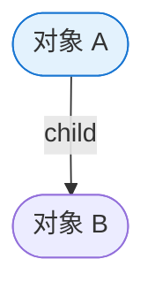
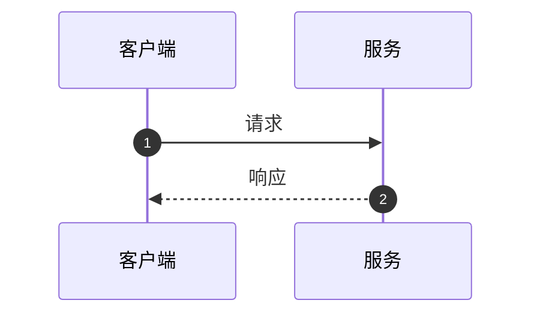

# 【规范协议】类技术文档撰写范式

适用于：行业规范（STAC、OGC API、OTel、OpenAPI）、通信协议（SNMP、HTTP/2）、数据格式标准、接口契约
"读完能按规范实现、能判断某个实现是否合规、知道去哪里查条款"。

判定信号：主题有**正式文本（标准/RFC/规范/Schema）**，读者关心"字段必填与否、取值是否合法、版本差异、不同实现的落地差别"。

---

## 一、结构骨架

| 序 | 章节 | 层级 | 写什么 | 篇幅占比 |
|----|------|------|--------|----------|
| 0 | 标题 + 导语 | H1 + 引用块 | 聚焦范围 + 结合的落地实现 | 2% |
| 1 | 一、概述 | H2 | 是什么、设计哲学、形态、标准化状态与版本 | 12% |
| 1.1 | 1.1 什么是 X | H3 | 加粗定义 + 定性 bullet | |
| 1.2 | 1.2 为什么需要 X | H3 | 痛点 → 三类角色的价值 | |
| 1.3 | 1.3 与既有规范的关系 | H3 | 复用/扩展关系 | |
| 2 | 二、核心概念与组件 | H2 | 组件表 + 关系图 + 术语定义 | 10% |
| 3..k | 三~五、逐对象详解 | H2 | 字段表（必填标注）+ 子对象 + 最小示例 | 25% |
| k+1 | 六、服务/接口层 | H2 | 规范组成、端点、参数、查询示例、形态对比 | 10% |
| k+2 | 七、扩展机制 | H2 | 前缀表、成熟度分级 | 8% |
| k+3 | 八、真实实现映射 | H2 | 某个具体平台如何落地 | 20% |
| k+4 | 九、实践示例 | H2 | 多语言代码 + 工具库索引 | 10% |
| k+5 | 十、关键要点速记 | H2 | 编号要点卡片 | 2% |
| k+6 | 十一、参考资源 | H2 | 规范原文、官方文档 | 1% |
| 附 | 十二、工具清单（可选） | H2 | CLI / SDK 命令与函数清单 | 补 |

> 规范类文档章节用**中文序号「一、二、三、」+ 阿拉伯小节「3.1」**，编号必须连续，不跳号。

---

## 二、各章写法细则

### 0. 导语：交代"聚焦什么、结合什么实现"

```markdown
# STAC 规范学习笔记

> 本笔记聚焦 **STAC（SpatioTemporal Asset Catalog，时空资产目录）规范**，并结合 **哥白尼海洋服务（CMEMS）** 的实际实现进行整理。
```

规范是抽象的，必须锚定一个真实实现，否则字段表读完无处可查。

### 1.1 什么是 X

- 首句：`**X（English Full Name）** 是 <制定方> 的一套<开放/正式>规范，旨在 <解决什么问题>。`（加粗术语 + 英文全称）
- 随后用 bullet 给**定性维度**，每维度一个标签加粗，避免流水账：

```markdown
- **「时空资产」**：任何在「特定地点 + 特定时间」捕获的、描述地球的文件。GeoJSON 本身不是资产，而是资产的索引。
- **设计哲学**：最小化核心 + 灵活扩展机制。
- **形态**：一组相互引用的 JSON 文件网络，遵循 HATEOAS 风格。
- **标准化**：已于 2025 年成为 OGC 社区标准：
  - **OGC 25-004**：STAC 规范 v1.1（[doc](https://docs.ogc.org/cs/25-004/25-004.html)）
- **当前稳定版本**：STAC Spec `1.1.0`，遵循语义化版本号。
```

- 版本号、标准编号一律给链接；版本状态（草案/社区标准/正式标准）必须写。

### 1.2 为什么需要 X

"传统做法的问题 → 采纳后的收益"，收益按**角色**分（提供者 / 消费者 / 运维），每条一句。

### 1.3 与既有规范的关系

明确"复用了谁、在哪一层扩展"。这决定读者已有的知识能不能迁移：

```markdown
最重要的对象 **Item** 本质是 **GeoJSON Feature** + 一组明确定义的附加属性。
**STAC API** 在 **OGC API - Features - Part 1: Core** 之上扩展，增加端点与对象属性（如 `/search`）。
```

### 2. 核心概念与组件

- 组件表三列：`|组件|角色|类比|`，类比用日常事物（"文件条目"、"目录树"、"数据集说明"）。
- 紧跟一张 mermaid 关系图，`classDef` 按对象类型分色，边标签写关系名（`child`、`item`、`asset href`）。
- 术语定义给**一句话 + 反例**（"GeoJSON 本身不是资产，而是资产的索引"），防止误用。

### 3~5. 逐对象详解

每个对象固定五段：

**a. 定位句**：该对象在整个体系中的角色，一句话。

**b. 字段表**：`|字段|类型|说明|`，**必填字段加粗并在说明里写"必填"**；类型列用规范写法（`string`、`[number]`、`map<string, Asset>`）。

```markdown
|字段|类型|说明|
|------|------|------|
|`type`|string|**必填**，GeoJSON 类型，必须为 `Feature`|
|`bbox`|[number]|**必填**，边界框 `[minLon, minLat, maxLon, maxLat]`|
|`collection`|string|所属 Collection 的 id（可选）|
```

**c. 子对象**：单独 H3，只写"是什么、何时用、与父对象的关系"。

**d. 取值约定**：枚举、roles、关系类型等列出合法集合，并说明推荐用法。

**e. 最小示例**：一份**能通过 schema 校验**的 JSON，字段顺序与字段表一致；省略部分用 `[...]` 明确标注。

### 6. 服务/接口层

- 规范由多个子规范组成时，用表讲清"哪个必需、哪个可选"。
- 参数按类分组（时空过滤 / 字段过滤 / 输出控制 / 分页），不按字母排。
- 给一个完整请求示例（`POST /search` + JSON body），示例里的每个键都能在参数表里找到。
- 静态形态 vs 动态形态对比，用 mermaid `flowchart LR` 双 subgraph，并配一句判断准则：

```markdown
> **关键认知**：规范定义「对象」，API 定义「服务」。同一个 Item JSON 在两种形态下完全一致，因此可从静态迁移到动态而无需改数据。
```

### 7. 扩展机制

- 扩展表：`|扩展|前缀|用途|`，前缀用 inline code（`eo:`、`proj:`）。
- 严肃对待成熟度：Candidate → Proposal → Pending → Stable，并给生产建议"优先 Stable"。
- 说明"该实现是否重度使用通用扩展"，避免读者照搬。

### 8. 真实实现映射（最能体现功力的一章）

必含六件套：

1. **端点与形态**：URL、静态还是动态、是否需要鉴权。
2. **层级映射表**：`|层级|规范角色|文件名/标识|含义|`——把规范的抽象层级对到真实文件与命名。
3. **资产/字段落地表**：实现里实际出现的键、取值习惯、后缀规则。
4. **标识符规则**：产品 ID、版本号格式、如何取最新版本（如"字典序最大者"）。
5. **访问流程图**：`mermaid sequenceDiagram`，参与者是"用户脚本 / 元数据服务 / 对象存储"，`autonumber` 编号，`Note over` 写关键结论。
6. **同类实现对比表**：`|维度|实现 A|实现 B|`，维度包括领域、形态、资产格式、版本、主用途。

容易混淆的地方必须显式区分：

```markdown
> **重要区分**：生态里有两个「STAC」，不要混淆：
>
> - **CDSE STAC**：面向 Sentinel 影像，是**动态 STAC API**。
> - **CMEMS STAC**：面向海洋数据立方体，是**静态 STAC Catalog**。
```

### 9. 实践示例

- 按语言/工具分 H3，每个示例 10~20 行、可运行、含"取最新版本"这类真实细节。
- 示例后给**工具库索引表**：`|语言|库|说明|`。
- 同一动作有多种路径时，给选型准则：

```markdown
> **选型直觉**：画某天海温图 → `timeChunked`；画某点 30 年海温曲线 → `geoChunked`。
```

### 10. 关键要点速记

编号 1..N，每条一句话，把"必须在脑子里留下的判断"固化下来（对象构成、静态优先、核心字段、三件套资产……），可作为 review 卡。

### 11. 参考资源

规范原文链接、官方文档、实现方文档，一行一条。

---

## 三、表达特征清单

1. 章节用中文序号（一、二、三），小节用阿拉伯数字（3.1），**编号连续不跳号**。
2. 必填/可选/默认值在字段表里显式标注，必填加粗。
3. 字段名、枚举值、常量、媒体类型一律 inline code。
4. 每条结论尽量带来源：标准编号、版本号、URL、条款号。
5. 关键判断用引用块统一格式：`> **关键认知**：` / `> **重要区分**：` / `> **选型直觉**：`。
6. 对比一律维度化（维度为行，实现为列）。
7. 术语中英对照只在首次出现时给，之后统一用中文或统一用英文缩写，不来回换。
8. 不确定的内容明确写"规范未规定 / 实现相关"，不臆造条款。
9. 示例中的占位符用 `{UPPER_SNAKE}` 或 `...`，并在首次出现处说明。
10. 不写"本文带你全面了解"这类开场，导语只交代范围与依据。

---

## 四、常见反例

| 反例 | 问题 | 改法 |
|------|------|------|
| 通篇转述规范条文 | 无落地、无法验证 | 每章绑定一个真实实现做映射 |
| 字段表不标必填 | 实现时踩坑 | 加"必填"标注与默认值 |
| 只讲对象不讲形态 | 不知道静态还是服务 | 加静态 vs 动态对比与判断准则 |
| 扩展一笔带过 | 字段看不懂前缀 | 前缀表 + 成熟度 + 该实现的取舍 |
| 版本信息缺失 | 半年后失效 | 标注版本号与获取日期 |
| 代码示例用伪代码 | 跑不起来 | 给可运行片段 + 工具库索引 |

---

## 五、可复制骨架

~~~~markdown
# <规范名> 规范学习笔记

> 本笔记聚焦 **<规范全称>**，并结合 **<真实实现>** 的实际实现进行整理。

## 一、概述

### 1.1 什么是 <X>

**<X>（<English>）** 是 …… 的一套规范，旨在 ……。

- **核心术语**：……
- **设计哲学**：……
- **形态**：……
- **标准化**：<标准编号 + 链接>
- **当前稳定版本**：`x.y.z`

### 1.2 为什么需要 <X>

### 1.3 与既有规范的关系

## 二、核心概念与组件

|组件|角色|类比|
|------|------|------|



## 三、<对象一> 详解

### 3.1 字段

|字段|类型|说明|
|------|------|------|

### 3.2 子对象
### 3.3 最小示例

```json
{}
```

## 四、<对象二> 详解

## 五、<对象三> 详解

## 六、<API / 服务层>

## 七、扩展机制

## 八、<真实实现> 的落地



## 九、实践示例

## 十、关键要点速记

1. ……

## 十一、参考资源
~~~~
