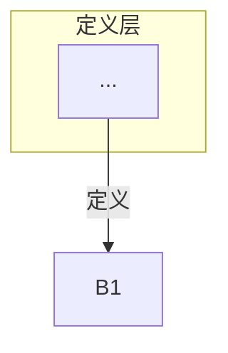

# 【系统机制】类技术文档撰写范式

适用于：架构组件、运行时机制、框架核心概念、平台扩展机制、工作原理剖析
"读完能理解为什么这样设计、各部件如何协作、怎么跑通一个最小可用实例"。

判定信号：主题是**多个概念/组件之间的协作关系**；读者的问题是"它是什么、为什么需要、彼此什么关系、内部怎么运转"。

---

## 一、结构骨架

| 序 | 章节 | 层级 | 写什么 | 篇幅占比 |
|----|------|------|--------|----------|
| 0 | 文档标题 | H1 | `<主题> 核心概念学习` / `<机制> 原理与实战` | — |
| 1 | 概述 | H2 | 一句话定义 + 概念类比 + 为什么需要 + 核心概念对比 + 发展历史 | 15% |
| 2..n | 逐组件详解 | H2 每个组件 | 是什么→结构解析→字段表→最小示例→常见操作→高级特性 | 40% |
| n+1 | 工作原理与关系 | H2 | 架构图 + 编号步骤 + 事件流 | 15% |
| n+2 | 完整实战 | H2 | 从零到跑通，步骤 1..N | 20% |
| n+3 | 最佳实践与注意事项 | H2 | 设计原则、调试技巧、生态对照 | 8% |
| n+4 | 总结 | H2 | 编号要点回顾 | 2% |

> 组件顺序按"依赖顺序"排：先被引用的先讲（定义层 → 实例层 → 控制层 → 执行层）。

---

## 二、各章写法细则

### 1. 概述：先用类比建立心智模型

固定四段，缺一不可：

**① 一句话定义**

```markdown
Kubernetes 提供了强大的扩展机制，允许用户在不修改源码的情况下扩展 API 能力。其中最核心的三个概念是 **CRD**、**CR** 和 **Operator**。
```

**② 多概念关系用"类比 + bullet"一次讲清**

```markdown
三者关系简单来说：

- **CRD** = 定义一种新的资源类型（相当于数据库表结构）
- **CR** = CRD 的实例（相当于数据库表中的记录）
- **Operator** = 基于 CRD 的自定义控制器，实现业务逻辑（相当于数据库的存储过程）
```

> 类比要贯穿全文可复用：后文提到 CR 时可直接说"相当于一条记录"。

**③ 为什么需要：对照表，需求驱动**

```markdown
|需求|原生 K8s|使用 Operator|
|------|------|------|
|部署 MySQL 集群|手动配置主从、复制|声明式创建，自动管理|
|自定义业务资源|不支持|完全自定义|
```

**④ 概念对比表 + 发展历史表**

```markdown
|概念|全称|类比|说明|
|------|------|------|------|
|CRD|Custom Resource Definition|数据库表结构|定义资源的 Schema|
```

```markdown
|时间|事件|
|------|------|
|K8s 1.7|引入 ThirdParty Resources (TPR)|
|K8s 1.8|引入 CRD，替代 TPR|
```

发展历史的作用是解释"为什么现在长这样"，不是罗列版本号。

### 2. 逐组件详解（每组件同一套节奏）

**a. 什么是 X**：加粗定义 + 通俗比喻 + 一句"简单来说"。

```markdown
**CRD（Custom Resource Definition）** 是 Kubernetes 中用于定义自定义资源类型的机制。

简单来说，CRD 就像是告诉 Kubernetes：「我想要一种新的资源类型，叫做 XXX，它有这些属性，请支持它！」
```

**b. 结构解析**：给一份**完整可用的配置**（YAML/JSON/代码），逐行/逐块中文注释，注释对齐。

```yaml
spec:
  group: example.com        # API 分组
  versions:
    - name: v1
      served: true
      storage: true         # 只有一个版本可以设为 true
```

**c. 关键字段表**：`|字段|说明|示例|`，示例列给真实取值。

**d. 最小可运行示例**：分步骤，每步"做什么 → 命令 → 期望输出"。

~~~~markdown
**步骤 1：编写 YAML 文件**

```yaml
...
```

**步骤 2：部署并验证**

```bash
kubectl apply -f myapp-crd.yaml
kubectl get crd
# 输出示例：
# NAME                CREATED AT
# myapps.example.com  2026-07-28T13:30:00Z
```
~~~~

**e. 常见操作**：编号命令清单，一条命令一句中文说明，覆盖增删改查 + 扩缩容 + 排障。

**f. 高级特性**：H4 小节，每特性 = 一句话价值 + 配置片段 + 效果示例。

- 归属关系表要写清"谁更新谁"：

```markdown
|部分|说明|谁来更新|
|------|------|------|
|`spec`|期望状态（Desired State）|用户定义|
|`status`|实际状态（Current State）|Operator/控制器更新|
```

- 生命周期用**状态图 + 状态表**双写：图给全局，表给触发条件（`|状态|说明|触发条件|`）。
- 参考实现/生态用对照表：`|框架|语言|特点|`、`|Operator|功能|仓库|`。

### 3. 工作原理与关系

- 一张 mermaid 架构图收束所有组件：分层 subgraph + 边上写动词（"定义"、"监听/调和"、"调用"），`classDef` 按层分色。
- 核心循环用**编号步骤**（1..6）配一句话说明，不要用长段落。
- 强调"声明式 vs 命令式"这类关键范式差异时，用引用块点明：

```markdown
> **关键认知**：控制器不关心"上次做了什么"，只关心"现在应该是什么"——所有逻辑都从期望状态重新推导。
```

### 4. 完整实战

标题写"完整实战：<做一件具体的事>"，然后 `#### 步骤 1：定义 X`（H4）依次推进，覆盖：定义 → 类型/接口 → 核心逻辑 → 部署 → 验证 → 变更 → 清理。代码可以长，但每段前必须有中文说明"这段在解决什么"。

### 5. 最佳实践与注意事项

- **设计原则**：编号列出，每条一句话 + 一句理由。
- **调试技巧**：能直接执行的命令（看事件、看日志、看 status）。
- **开发注意事项**：幂等、终态、OwnerReference、Finalizer 之类的坑，写成"现象 → 原因 → 建议"。

### 6. 总结

编号回扣全文（1..N），每条不超过两句，作为复习卡片。

---

## 三、表达特征清单

1. **类比优先**：每个抽象概念都配"相当于……"，降低入门门槛。
2. **定义加粗**：术语首次出现用 `**术语（English）**` 形式。
3. 配置/代码给完整版，不给"省略若干"的残片；必须省略时用注释标 `# ... 其他配置`。
4. 命令后紧跟期望输出（用 `#` 注释形式），让读者能自我校验。
5. 状态、角色、责任一律表格化。
6. 图只画关系与流程，不画装饰；边标签用动词。
7. 每章回答"为什么这样设计"，而不只是"API 长什么样"。
8. 术语一致：全文只用一种叫法（如统一用"调和循环"，不混用"对账/协调"）。
9. 演进信息（版本、GA 时间）服务于解释现状。
10. 不夸大（"完全自动化""零运维"），写明边界条件。

---

## 四、常见反例

| 反例 | 问题 | 改法 |
|------|------|------|
| 上来就贴 CRD YAML | 读者不知道为何存在 | 先"为什么需要"+ 类比，再贴配置 |
| 三个概念各讲一遍，不讲关系 | 拼不起来 | 加关系图 + 概念对比表 |
| 只列 API 字段 | 用完即忘 | 每个字段给"为什么需要它" |
| 实战示例缺验证步骤 | 不知道成功没有 | 每步给期望输出 |
| 通篇散文讲原理 | 无法定位 | 原理拆成编号步骤 + 图 |
| 生命周期只有文字 | 状态边界不清 | 状态图 + 触发条件表 |

---

## 五、可复制骨架

~~~~markdown
# <主题> 核心概念与实战

## <主题> 核心概念学习

### 概述

<一句话定义>

三者关系简单来说：

- **A** = ……（相当于 ……）
- **B** = ……（相当于 ……）

### 为什么需要 <机制>？

|需求|原生方案|本机制|
|------|------|------|

### 核心概念对比

|概念|全称|类比|说明|
|------|------|------|------|

### 发展历史

|时间|事件|
|------|------|

## <组件 A> 详解

### 什么是 A？
### A 的结构解析
### A 关键字段说明
### 创建第一个 A

## <组件 B> 详解

### 什么是 B？
### 创建 B 实例
### B 的状态与生命周期
### B 的常见操作
### B 的高级特性

## 工作原理与关系



## 完整实战：<做一件具体的事>

#### 步骤 1：……
#### 步骤 2：……
#### 步骤 3：……

## 最佳实践与注意事项

### 设计原则
### 调试技巧
### 开发注意事项

## 总结
~~~~
